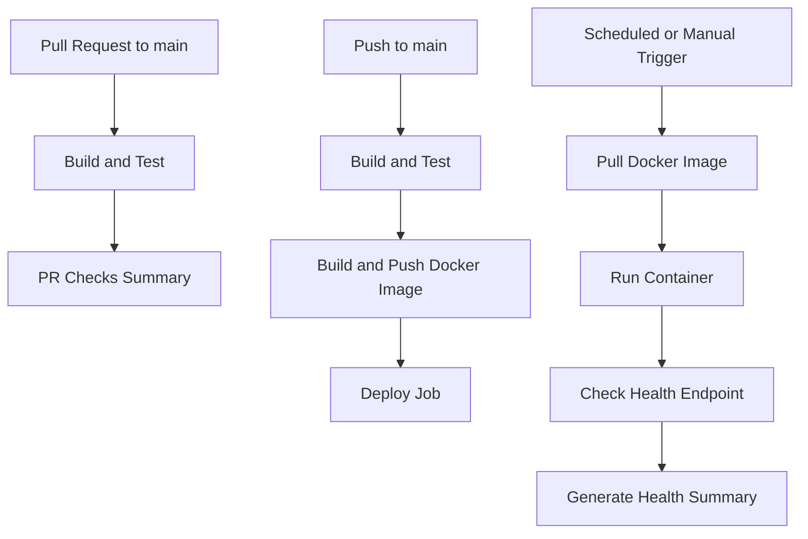

# Day 48: GitHub Actions Capstone Project

A hands-on end-to-end CI/CD project using GitHub Actions, reusable workflows, Docker, and scheduled health checks.

## 🚀 Project Links

- **Capstone Project:** [GitHub Actions Capstone](https://github.com/DastureSachin/github-actions-capstone)
- **Day 48 Assignment:** [README.md](./README.md)
- **Main Pipeline:** [main-pipeline.yml](https://github.com/DastureSachin/github-actions-capstone/blob/main/.github/workflows/main-pipeline.yml)
- **PR Pipeline:** [pr-pipeline.yml](https://github.com/DastureSachin/github-actions-capstone/blob/main/.github/workflows/pr-pipeline.yml)
- **Reusable Build and Test:** [reusable-build-test.yml](https://github.com/DastureSachin/github-actions-capstone/blob/main/.github/workflows/reusable-build-test.yml)
- **Reusable Docker Workflow:** [reusable-docker.yml](https://github.com/DastureSachin/github-actions-capstone/blob/main/.github/workflows/reusable-docker.yml)
- **Scheduled Health Check:** [health-check.yml](https://github.com/DastureSachin/github-actions-capstone/blob/main/.github/workflows/health-check.yml)

## 📌 Project Overview

The objective of this capstone is to combine the GitHub Actions concepts learned from Day 40 to Day 47 into one end-to-end CI/CD pipeline.

The project uses a Python Flask application with automated tests, Docker containerization, reusable GitHub Actions workflows, Docker Hub image publishing, and scheduled health checks.

### Key Objectives

- Automate application testing.
- Reuse workflows to reduce duplication.
- Build and publish Docker images.
- Separate pull request checks from main branch publishing.
- Use commit-based image tags for traceability.
- Run scheduled health checks.
- Generate workflow execution summaries.

## 🏗️ Pipeline Architecture

### Pipeline Flow

**Pull Request Pipeline**

1. A pull request is opened or updated.
2. The application is checked out and dependencies are installed.
3. Automated tests run.
4. A summary reports the result.
5. Docker images are not published from this pipeline.

**Main Branch Pipeline**

1. Code is pushed or merged into `main`.
2. The build-and-test workflow runs.
3. The Docker workflow builds and pushes the image.
4. The image is tagged with `latest` and a short commit SHA.
5. The deployment job runs after the Docker job.

**Scheduled Health Check**

1. The workflow starts every 12 hours or through a manual trigger.
2. The latest Docker image is pulled.
3. A container is started.
4. The `/health` endpoint is checked.
5. A pass/fail summary is written to the GitHub Actions run.

> Note: The deployment job currently demonstrates the deployment handoff. A real production deployment requires a configured deployment target.

## 🐍 Application Details

The Flask application exposes two endpoints.

| Endpoint | Purpose | Expected result |
| --- | --- | --- |
| `/` | Welcome response | HTTP 200 |
| `/health` | Health verification | HTTP 200 with healthy status |

The application is tested with `pytest` before Docker image publishing.

## ⚙️ Workflow Details

### 1. Reusable Build and Test

File: `.github/workflows/reusable-build-test.yml`

This workflow uses `workflow_call` so other workflows can reuse the same testing process.

Responsibilities:

- Check out the repository.
- Configure the Python runtime.
- Install dependencies.
- Run tests when enabled.
- Expose a test-result output.

### 2. Reusable Docker Build and Push

File: `.github/workflows/reusable-docker.yml`

This workflow builds and publishes the application image to Docker Hub.

Responsibilities:

- Authenticate to Docker Hub.
- Build the Docker image.
- Push the requested image tag.
- Generate a short commit SHA tag.
- Expose the published image URL.

Required GitHub Actions repository secrets:

- `DOCKER_USERNAME`
- `DOCKER_TOKEN`

**Security note:** Never store Docker credentials directly in workflow YAML, application code, or public documentation.

### 3. Pull Request Pipeline

File: `.github/workflows/pr-pipeline.yml`

The PR pipeline calls the reusable build-and-test workflow and generates a summary after the tests finish.

The pipeline intentionally does not publish Docker images for pull requests.

### 4. Main Branch Pipeline

File: `.github/workflows/main-pipeline.yml`

The main pipeline coordinates three jobs:

1. `build-test` — validates the application.
2. `docker` — builds and pushes the Docker image.
3. `deploy` — demonstrates the deployment stage using the published image URL.

The Docker image uses two tags:

- `latest`
- `sha-<short-commit-hash>`

The commit SHA tag helps identify the exact version of the application associated with a build.

The workflow uses the `production` GitHub environment. Required reviewers and approval rules can be configured in repository settings.

### 5. Scheduled Health Check

File: `.github/workflows/health-check.yml`

The workflow supports scheduled execution every 12 hours and manual execution through `workflow_dispatch`.

Responsibilities:

- Pull the published Docker image.
- Start a container.
- Wait for the application to start.
- Check the `/health` endpoint.
- Record the health-check result.
- Remove the container even if the check fails.
- Write a report using `$GITHUB_STEP_SUMMARY`.

## 🔐 Security and Reliability

Security and reliability improvements included in this project:

- Store credentials in GitHub Actions secrets.
- Use limited workflow permissions.
- Tag images with commit SHAs for traceability.
- Clean up containers after health checks.
- Consider adding Trivy image scanning.
- Fail the pipeline when critical vulnerabilities are detected.
- Configure environment protection rules for production deployments.

## ✅ Validation Checklist

Update this checklist after verifying each item in your repository.

- [x] Flask application and basic endpoint tests created.
- [x] Dockerfile added and image tested locally.
- [x] Reusable build-and-test workflow created.
- [x] Main pipeline previously completed its build-test, Docker, and deploy jobs successfully.
- [ ] Verify the latest main pipeline after the SHA-tag changes.
- [ ] Verify that a pull request runs tests without publishing a Docker image.
- [ ] Verify that the scheduled health-check workflow succeeds.
- [ ] Add screenshots of the PR pipeline, main pipeline, and health check.
- [ ] Add the exact Docker Hub image URL.
- [ ] Verify the production environment settings.

## 📸 Screenshots to Add

Add screenshots from your actual GitHub Actions runs to document the project.

1. Successful pull request pipeline.
2. Successful main branch pipeline showing the job sequence.
3. Successful Docker image publishing.
4. Successful scheduled or manual health check.
5. Docker Hub repository showing the published image tags.

## 🚀 What I Would Improve Next

1. Connect the deployment job to a real hosting or cloud platform.
2. Add Trivy container image vulnerability scanning.
3. Upload security scan reports as workflow artifacts.
4. Add notifications for pipeline failures.
5. Introduce staging and production environments.
6. Implement deployment rollback.
7. Add retries and more detailed diagnostics to health checks.

## 🎯 Key Learnings

This capstone demonstrates how GitHub Actions can automate the software delivery process.

- **Reusable workflows** reduce duplicated pipeline logic.
- **Job dependencies** control execution order.
- **GitHub Actions secrets** protect sensitive credentials.
- **Docker image tags** support version identification and traceability.
- **Pull request pipelines** validate changes before merging.
- **Scheduled workflows** automate recurring health checks.
- **Workflow summaries** make results easier to understand.

**Day 48 completed: GitHub Actions Capstone Project**

#90DaysOfDevOps #DevOpsKaJosh #TrainWithShubham
